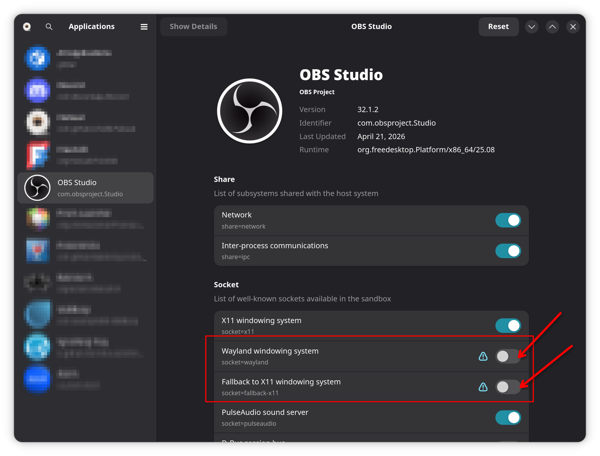
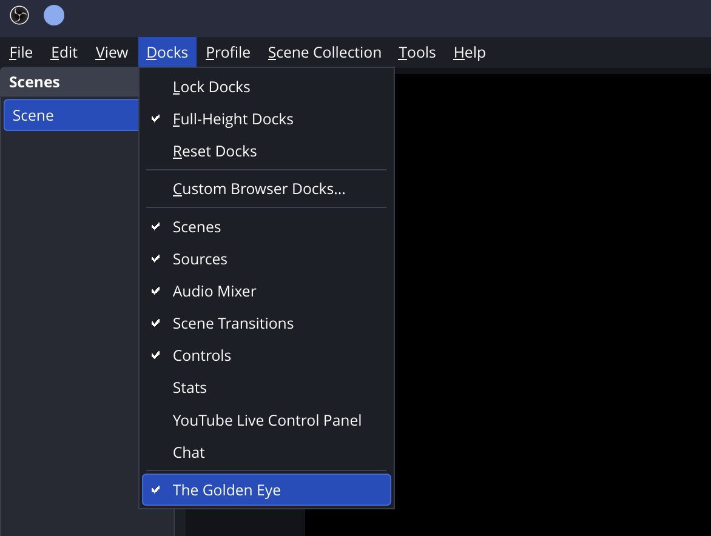

# Installing on Linux

## Requirements

It's recommended that you install and use the flatpak version of OBS Studio, this is also the
recommended install method from the OBS developers. The flatpak version also includes the embedded
browser which this plugin needs for its UI to work inside of OBS.

### Using without flatpak OBS

You can use this plugin without the flatpak version, but you'll need to have the plugin's UI open in
a browser rather than inside OBS itself. OBS won't have browser docks and thus the plugin won't be
visible inside OBS.

The flatpak really is the better option for now (use it!).

### Using with flatpak OBS

If you're using a Wayland window server (if you don't know what this is, you probably are) you also
need to make sure that OBS runs in X11 mode. OBS's embedded browser doesn't work in Wayland - you
can't have the plugin UI inside OBS without it.

The easiest way to do this is to install Flatseal and configure OBS like so:



This is also possible via the command line if you're so inclined:

```bash
flatpak run --socket=x11 --nosocket=wayland --nosocket=fallback-x11 com.obsproject.Studio
```

## Installing the plugin

Download the latest release from the
[releases page](https://github.com/acheronfail/the_golden_eye/releases) and extract it and copy the
`the_golden_eye` folder to your OBS Studio plugins directory.

For Flatpak OBS 33+, use: `$HOME/.var/app/com.obsproject.Studio/data/obs-studio/plugins/`

For OBS 31/32, use: `$HOME/.var/app/com.obsproject.Studio/config/obs-studio/plugins/`

The same download works with both versions of OBS. If you already use the plugin on OBS 31 or 32,
update the plugin and open OBS at least once before upgrading OBS. The plugin will automatically
prepare the OBS 33+ folder for you.

If the dashboard asks you to reinstall before upgrading OBS, close OBS and copy the latest plugin
into the OBS 33+ folder listed above before upgrading.

Now open OBS Studio or restart it, and the plugin should appear as an integrated window. If it
doesn't appear, open the `Docks` menu item and make sure that `The Golden Eye` is checked:



## Uninstalling the plugin

Close OBS and delete the `the_golden_eye` folder from both Flatpak plugin locations listed above, if
present, then restart OBS. Remove both copies so the plugin does not recreate one when OBS starts.
Your settings and run history are kept separately and will remain saved.

Open `Docks` -> `Custom Browser Docks` and remove the entry for `The Golden Eye` if it is still
present.
