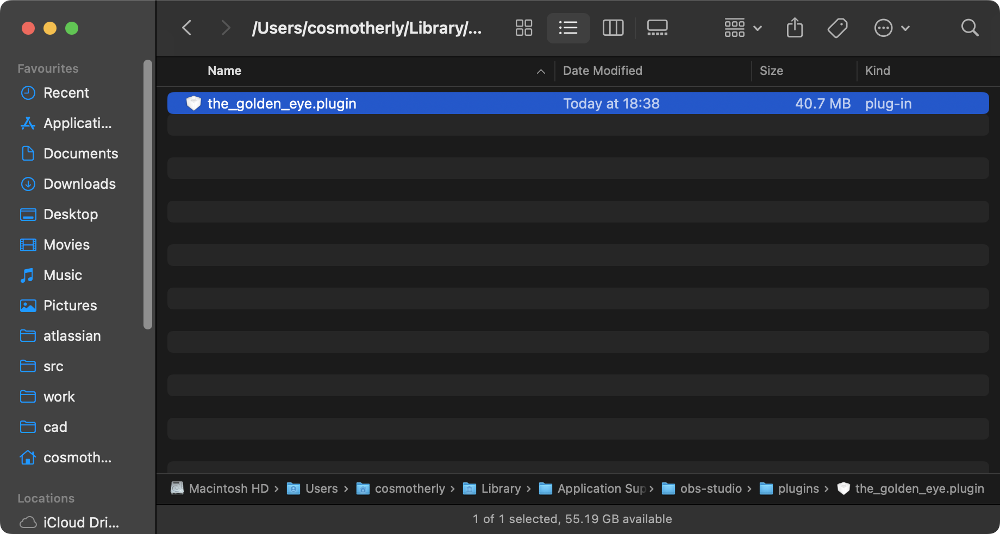
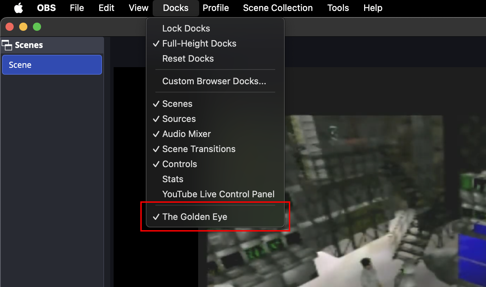

# Installing on macOS

## Requirements

Have OBS Studio installed in `/Applications`.

## Installing the plugin

1. Quit OBS Studio.
2. Download the macOS ZIP from the
   [latest release](https://github.com/acheronfail/the_golden_eye/releases/latest): choose
   `macos-arm64` for Apple silicon or `macos-x86_64` for Intel. If OBS runs under Rosetta, use
   `macos-x86_64`.
3. Double-click the ZIP to extract `the_golden_eye.plugin`.
4. In Finder, choose **Go → Go to Folder…** and paste:

   ```text
   ~/Library/Application Support/obs-studio/plugins/
   ```

   Create the `plugins` folder if it doesn't exist. Copy `the_golden_eye.plugin` into it, replacing
   the existing bundle when upgrading.

Release packages are Developer ID signed and notarised by Apple.



### Start up OBS

Now open OBS Studio or restart it, and the plugin should appear as an integrated window. If it
doesn't appear, open the `Docks` menu item and make sure that `The Golden Eye` is checked:



## Uninstalling the plugin

To uninstall the plugin, simply delete the `the_golden_eye.plugin` directory from your OBS Studio
plugins directory. This is usually at `$HOME/Library/Application Support/obs-studio/plugins/`, and
then restart OBS Studio.

Open `Docks` -> `Custom Browser Docks` and remove the entry for `The Golden Eye` if it is still
present.
