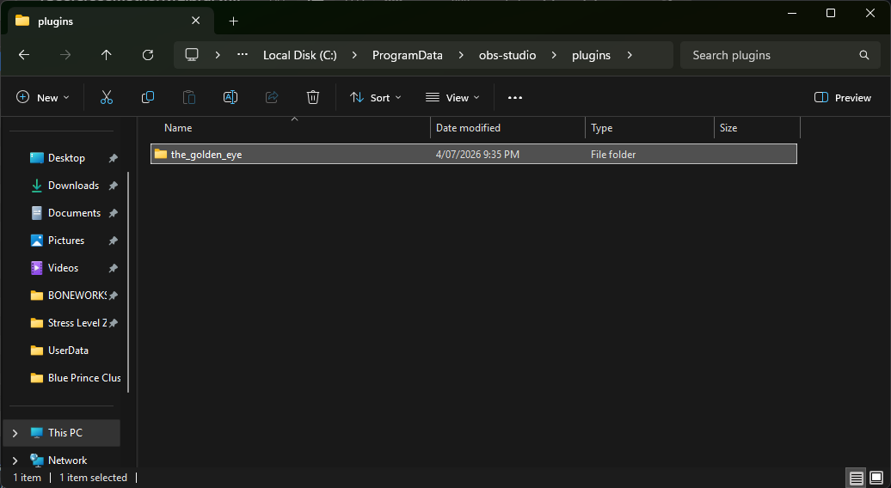
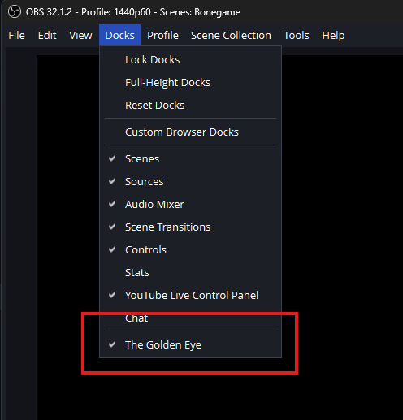

# Installing on Windows

## Requirements

Have OBS Studio installed.

## Installing the plugin

Download the Windows zip from the
[releases page](https://github.com/acheronfail/the_golden_eye/releases) and extract it.

Copy the extracted `the_golden_eye` folder to OBS Studio's recommended Windows plugin directory:

```text
C:\ProgramData\obs-studio\plugins
```

The same download and installation folder work with OBS 31, 32, and 33 or later. Copy the entire
`the_golden_eye` folder, keeping all of its contents together.

If you already use the plugin, update it and open OBS at least once before upgrading OBS. The plugin
will automatically prepare for the newer OBS version.



Now open OBS Studio or restart it, and the plugin should appear as an integrated window. If it
doesn't appear, open the `Docks` menu item and make sure that `The Golden Eye` is checked.



## Uninstalling the plugin

Delete this folder and restart OBS Studio:

```text
C:\ProgramData\obs-studio\plugins\the_golden_eye
```

Open `Docks` -> `Custom Browser Docks` and remove the entry for `The Golden Eye` if it is still
present.
